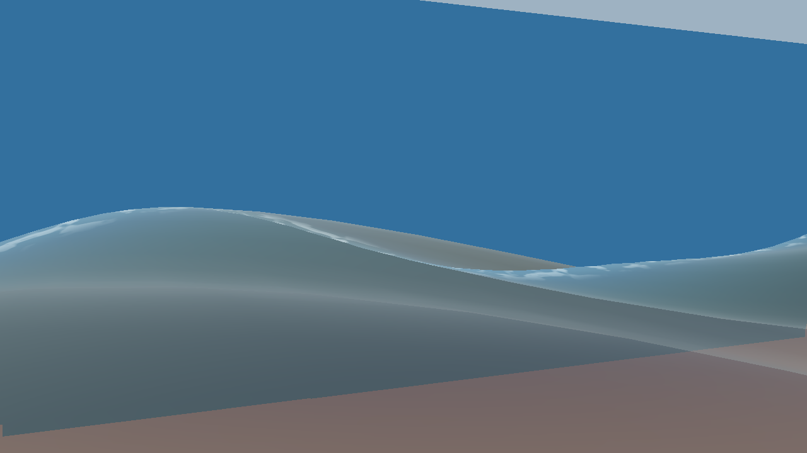
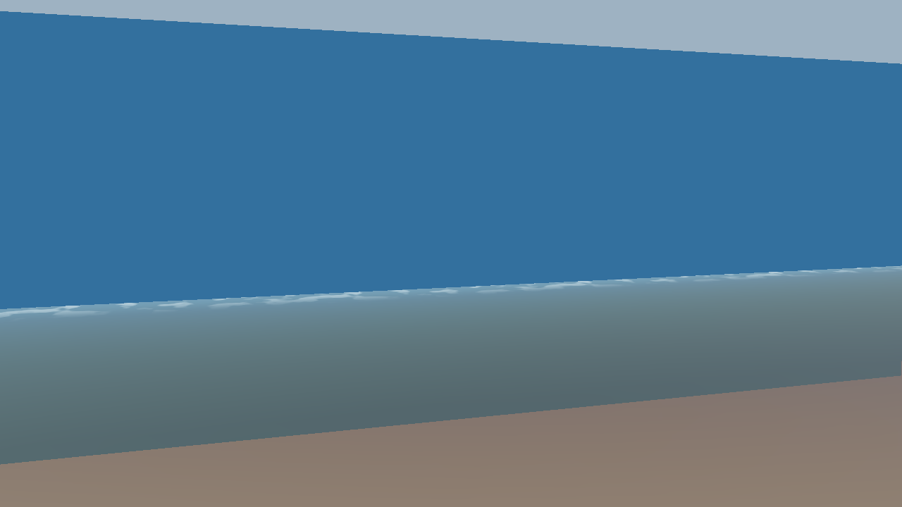
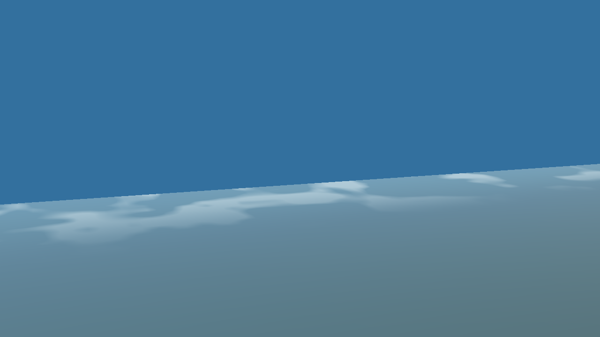
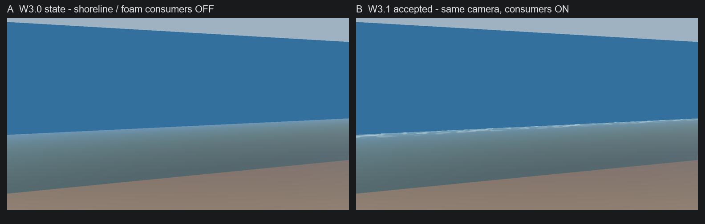
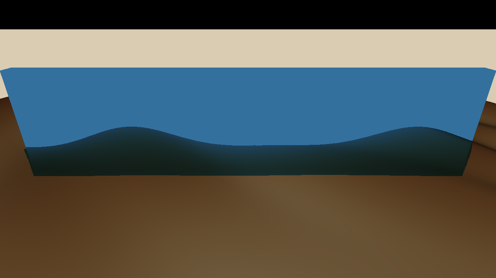
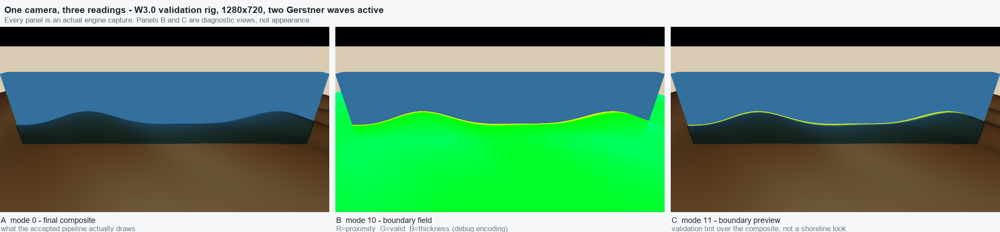
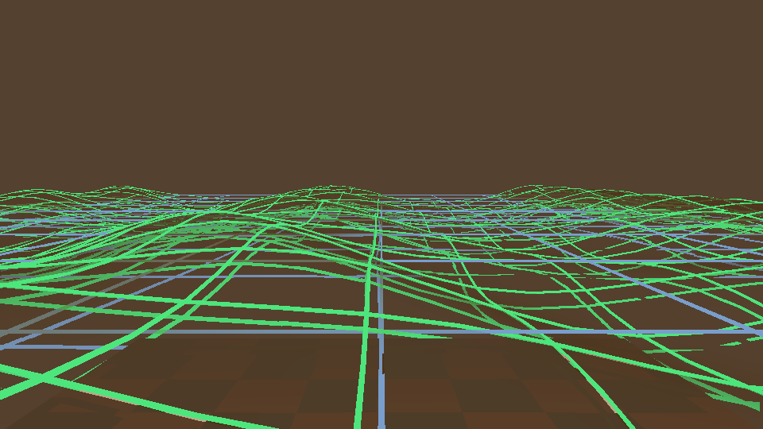

# FluidMatter Water

**Real-time Water Rendering System | Unity URP Technical Art**

A modular water surface built as a data-contract problem: one owner per quantity, one definition per
quantity, and an automated gate that measures the result instead of a screenshot that happens to look
right from one angle.

**Status:** W0 – W3.1 accepted (see [validation scope](#how-much-of-this-is-measured)) ·
W4.0 caustics implemented, **validation pending** · portfolio scene created, **visual review pending** ·
research prototype, not a product.

*Actual engine capture, debug mode 0 (final composite), 1280×720. Shows Gerstner surface displacement,
the shoreline band and the noise-broken foam layer, from the **accepted W3.1** validation rig. It is an
honest technical capture, not an art pass — the project's first art-directed scene has not been rendered
yet, and that is stated rather than covered up.*

---

## Gallery

Every image below is a real capture from this project's own engine runs. None is AI-generated, none is a
marketing render, and no diagnostic view is presented as finished appearance.

| | |
|---|---|
|  | **Beer–Lambert absorption + shoreline band.** A still, clear pool seen at a low angle: the colour shift from the contact edge into depth is thickness-driven absorption, and the thin bright line at the contact is the shoreline layer.   Milestone **W3.1** · debug mode **0 = final composite** · **accepted** · validation rig, not an art pass |
|  | **Shoreline foam, close enough to read the structure.** The foam layer is thresholded noise, so it breaks up into cells instead of painting a uniform stripe; the band hugs the contact line and dies out on schedule.   Milestone **W3.1** · mode **0 = final composite** · **accepted** · validation rig |
|  | **What the W3.1 consumer actually changes — same camera, nothing else different.** Panel A is the W3.0 state with the consumers off; panel B is the accepted W3.1 state with them on. The pair is one pose differing only in two enable flags, which is why it can be compared at all.   Milestone **W3.1** · mode **0** · **accepted** · *assembled figure: two unmodified captures, resized and labelled, no pixels painted* |
|  | **The accepted W3.0 build.** Two active Gerstner waves, depth-driven absorption at the contact edge, displaced silhouette. Kept here because it is the state before the shoreline consumer existed.   Milestone **W3.0** · mode **0 = final composite** · **accepted** · validation rig |
|  | **One view, three readings.** A = what the build draws. B = the boundary *field* (R proximity, G validity, B normalised thickness). C = a validation tint. Panels B and C are **diagnostic views, not appearance** — they show the data a consumer reads, which is the point of the architecture.   Milestone **W3.0** · modes 0 / 10 / 11 · **accepted** · assembled figure |
|  | **Engineering proof, not a look.** Multi-wave superposition against the harness's CPU reference; the green/blue polylines are the rig's own analytic curves. Published because "the GPU agrees with an independent implementation" is a claim worth showing.   Milestone **W2.1** · mode **0** · **accepted** · technical evidence |

**What is deliberately missing from this gallery:** a beauty shot, a video, and any caustics image. See
[Visual status](#visual-status--what-is-not-here-yet).

---

## What the system does

| Capability | What it means here |
|---|---|
| **Unity / Tuanjie URP** | Built and validated inside the URP forward path through a pipeline adapter; Core shader modules own generic maths and never touch engine services directly. |
| **Modular water rendering** | Depth, surface data, waves, optics, boundary and shoreline are separate modules with declared include-direction; ownership is checked by the gates, not by convention. |
| **Depth-based Beer–Lambert absorption** | Per-channel transmittance, monotonic non-increasing in water thickness, with one positive linear eye-depth convention feeding everything. |
| **Screen-space refraction** | Normal-derived offset with a bounded maximum, viewport-edge fallback, and explicit rejection of foreground geometry dragged below the waterline. |
| **Environment reflection + Fresnel** | Reflection vector + Schlick Fresnel composed against environment probe content. Labelled **preview** everywhere: it is not SSR and not planar reflection. |
| **Layered surface normals** | Geometry normal and shaded normal are separate members of one `SurfaceData` contract, so a normal map can shade a surface without silently changing its geometry. |
| **Gerstner waves** | Up to four authored slots (direction, amplitude, wavelength, speed, steepness); CPU-reference vs GPU agreement is graded, and the crest-folding limit is stated by the model rather than hidden. |
| **Shoreline / foam** | A depth-derived boundary field drives a shaped shoreline band and a world-space noise-thresholded foam layer. **Accepted at W3.1.** |
| **Profile / binding architecture** | Authored ScriptableObject profiles → binder → shader properties, through two backends (shared material cache and `MaterialPropertyBlock`) proven pixel-identical; hostile payloads sanitised at the system edge. |
| **Automated validation** | Headless in-editor gates render controlled rigs, compare against a CPU reference of the same maths, and write graded rows with expectations and verdicts. A pass can be re-derived from numbers. |

---

## Progress

| Stage | Public status |
|---|---|
| W0 – W3.1 (depth, refraction, absorption, reflection preview, surface normals, Gerstner, surface-data contract, boundary field, shoreline + foam) | **Accepted**, subject to recorded validation scope |
| W4.0 Caustics | **Implemented / Validation Pending** — present in the working tree, gated by its own CAU series, **not accepted**, and no image of it is published here |
| Showcase Island (portfolio scene, cinematic profile, three cameras) | **Scene asset created / Visual review pending** — imported by the engine and structurally validated; **no rendered frame captured yet** |
| W4.1 / W5 | **Not started** |

---

## How much of this is measured

Not by looking at it and nodding.

- **W3.1 shoreline + foam:** `SHORELINE_TEST.csv` carries **342 graded rows, all PASS**, across twelve
  consumer gates plus calibration, beauty and performance arms. Among them: disabled-identity reproduces
  the W3.0 render with max channel difference `0.00000` over 469,236 owned pixels; the shipped shoreline
  curve is flat at both band endpoints (`0.00300` / `0.00298` slope per unit proximity) because a linear
  band reads as an outlined ring; the mask matches its own analytic shape to `0.00033` against a capture
  floor of `0.00195`.
- **Full regression:** **16 gates × 2 independent passes (sequential + isolated), all PASS**, exit code 0,
  every gate snapshotting 265 project files, `isolation_unresolved = 0` with **drifted 36 == restored 36**
  across the isolated pass, `errorCS = 0`, `shaderError = 0`, `ioError = 0`, `files_created_by_gate = 0`,
  no accepted asset left mutated.
- **W3.0 boundary field:** 15 gates × 2 passes, 3,343 graded rows, 0 FAIL.
- **Failures are kept, not deleted.** Six W3.1 failing runs are archived with their FAIL rows, so the
  record still shows fail → root-cause → fix → pass. Thresholds were never lowered to obtain a pass; where
  a bar was wrong, it was replaced by a *correct* bar and still graded against.

---

## Known Limitations

Stated as gaps, not as settled conclusions.

1. **Refraction is screen-space.** It can only move information already in the scene colour/depth buffers.
   It cannot recover occluded detail, and it is not ray-traced.
2. **Reflection is a preview path.** Environment probe + Fresnel. **There is no screen-space reflection and
   no planar reflection.** In this engine fork, probe content does not reach the shader's environment
   globals through the standard path in headless runs, which is why the reflection evidence is graded
   against a controlled probe rather than an arbitrary skybox.
3. **Depth is view-axis thickness.** `thicknessEye` is measured along the view ray, not as the shortest
   distance to shore. Measured band width varies up to **4.98×** across a 30° view ramp — a published
   limitation, not smoothed over.
4. **Opaque scenery only.** Transparent objects never reach the depth texture, so the shoreline reports no
   contact against them — correctly, but silently. Water cannot touch water: one depth sample, one surface.
5. **Coverage is a field-level calibration, not a band-level promise.** Authored foam coverage matches the
   measured areal fraction of the whole noise field to ≤`0.001`, but a specific shoreline band measured
   `0.47995` against a predicted `0.60000`. An author who needs "x % of this shore has foam" must calibrate
   on that shore.
6. **No GPU performance figures exist.** The headless capture path costs as much as or more than the frame
   it captures, so no enabled/disabled shader delta was resolvable above harness noise. "Not measured" must
   not be read as "free". No FPS, no ms, no per-pass cost is claimed anywhere in this repository.
7. **Caustics are not accepted.** A caustics consumer exists in the working tree and is under its own
   validation series with unresolved failing rows. Nothing here claims physically accurate caustics, flux
   conservation, or a finished underwater look.
8. **There is no beauty pass yet.** Every image on this page comes from a controlled test rig with known
   geometry and flat unlit scenery, chosen so the measurements mean something.

---

## Not implemented / not claimed

Physically accurate caustics · flux-conserving caustics · ray-traced water · screen-space reflections ·
planar reflections · full underwater rendering · open-water crest foam · wakes · interaction foam ·
FFT / infinite ocean · flow maps · buoyancy · GPU benchmarks · cross-API certification · a 30-second demo
video.

A term appearing in a roadmap, a design note, or an in-progress source file is not evidence that it ships.

---

## Visual status — what is not here yet

**Beauty cover: NEEDS_CAPTURE.** The gallery above is honest engine output from validation rigs. The
project's first art-directed water scene (`FMS_Showcase_Island`) exists as a scene asset with a cinematic
profile and three cameras, and has been imported and structurally validated — but it has **not been
rendered and reviewed yet**, so no image from it is published.

**Motion demo: NEEDS_CAPTURE.** No actual-run clip is published.

**Caustics imagery: not published.** The W4.0 captures that exist are 256–512 px diagnostic field dumps
over a marker grid; none shows a water surface a viewer could judge, and the milestone is not accepted.

No generated or AI-produced imagery is used anywhere in this repository, and none is used to fill these gaps.

---

## Environment

Tuanjie 1.10.4 (Unity-compatible 2022.3.62t16) · URP 14.2.0-t1 · Direct3D 11 · HLSL / ShaderLab ·
C# editor automation · perspective validation rigs at 1280×720.

## Repo scope & rights

This repository is a **showcase**: selected documentation and rendered evidence only. Full project source,
scenes, shaders and engine/package content are not distributed here, and public visibility is not an
open-source licence. Third-party engine and pipeline names belong to their respective rights holders.
See [media attribution](docs/media-attribution.md) for per-image provenance and integrity hashes.

**More detail:** [technical overview](docs/technical-overview.md) ·
[validation & evidence](docs/validation-and-evidence.md) · [status & limitations](docs/status.md) ·
[media attribution](docs/media-attribution.md)
